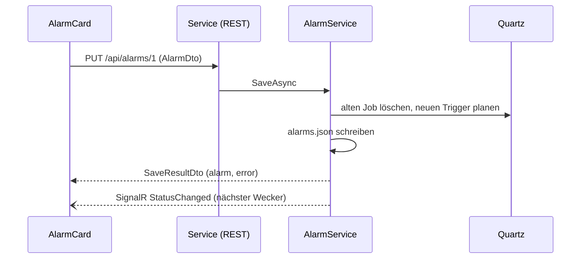
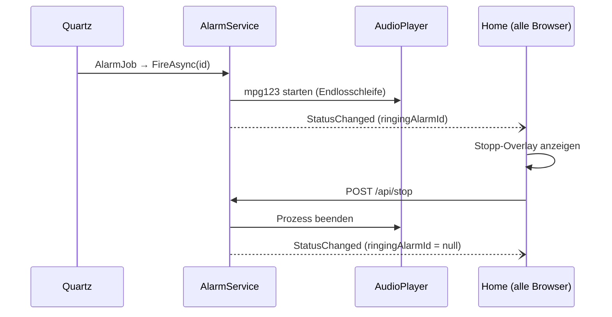

# Wecker – Projektdokumentation

Ein Wecker für den Raspberry Pi mit Touch-Weboberfläche. Drei Wecker, jeder mit Uhrzeit, Wiederholung und MP3.
Der Wecker klingelt auch, wenn die Weboberfläche gerade nicht läuft oder kein Browser offen ist.

Weitere Dokumente:
[API-Kurzreferenz](API.md) · [OpenAPI](openapi.yaml) · [Contracts](Contracts.md)

---

## 1. Funktionsumfang

- Drei Wecker (Wecker 1–3) mit Ein/Aus, Uhrzeit (Touch-Picker), Modus **Einmalig / Täglich / Werktags** und MP3-Auswahl
- Musik wird in Endlosschleife abgespielt, bis „Stopp“ gedrückt wird (Sicherheitsstopp nach 10 Minuten)
- MP3-Upload und -Löschen direkt in der UI
- Probehören einer Datei
- Roter „Aus“-Button: Raspberry sofort oder zeitgesteuert herunterfahren
- Einstellungen bleiben über Neustarts erhalten
- Mehrere Browser/Geräte gleichzeitig: Änderungen erscheinen live überall

## 2. Architektur

```
 Browser (Tablet / Handy / PC)
        │  HTTP, Blazor-Verbindung (SignalR)
        ▼
┌──────────────────────────┐   REST + SignalR    ┌──────────────────────────────┐
│ Wecker.Web  (Port 5000)  │ ──────────────────► │ Wecker.Service (Port 5001)   │
│ Blazor Server, MudBlazor │ ◄────────────────── │ Quartz, Dateien, mpg123      │
│ nur Oberfläche           │   Status-Events     │ systemd-Dienst, enthält Logik│
└──────────────────────────┘                     └──────────────┬───────────────┘
            └────────── Wecker.Contracts (gemeinsame Datentypen) ─┘     │
                                                                        ▼
                                              /var/lib/wecker  (alarms.json, shutdown.json, music/)
                                              Audio-Ausgang des Raspberry
```

**Leitgedanke:** Die Oberfläche enthält keine Logik. Sie zeigt an und schickt Befehle an den Service.
Der Service ist allein zuständig für Zeitplanung, Speicherung, Tonausgabe und Herunterfahren.
Fällt die Oberfläche aus, klingeln die Wecker trotzdem.

**Warum der Ton im Service entsteht:** Ein Browser darf Ton nur nach einer Nutzeraktion abspielen und nur, solange die Seite offen ist.
Deshalb startet der Service auf dem Raspberry selbst einen Player (`mpg123`).

### Ports und Erreichbarkeit

| Programm | Adresse | Erreichbar von |
|---|---|---|
| Wecker.Service | `127.0.0.1:5001` | nur dem Raspberry selbst |
| Wecker.Web | `0.0.0.0:5000` | gesamtes lokales Netz |

### Daten auf dem Raspberry

| Pfad | Inhalt |
|---|---|
| `/opt/wecker/service`, `/opt/wecker/web` | veröffentlichte Programme |
| `/var/lib/wecker/alarms.json` | die drei Wecker |
| `/var/lib/wecker/shutdown.json` | Zeitplan für das Herunterfahren |
| `/var/lib/wecker/music/` | MP3-Dateien |
| `/etc/systemd/system/wecker-*.service` | Dienstdefinitionen |
| `/etc/sudoers.d/wecker` | Erlaubnis zum Herunterfahren |

## 3. Projekte und Module

```
WeckerSln/
├─ src/
│  ├─ Wecker.Contracts/   gemeinsame Datentypen
│  ├─ Wecker.Service/     Logik, systemd-Dienst
│  └─ Wecker.Web/         Blazor-Oberfläche
├─ deploy/                systemd-Units, publish.sh, setup-pi.sh
└─ docs/                  diese Dokumentation
```

Abhängigkeiten: `Web → Contracts ← Service`. Web und Service kennen sich nicht.

### 3.1 Wecker.Contracts

Gemeinsame Datentypen (`AlarmDto`, `StatusDto`, `ShutdownDto`, …) und Konstanten (`ApiRoutes`).
Keine Logik, keine Pakete. Ausführlich in [Contracts.md](Contracts.md).

### 3.2 Wecker.Service

Technik: ASP.NET Core (nur für die API), Quartz.NET, SignalR, `Microsoft.Extensions.Hosting.Systemd`.

| Modul | Datei | Aufgabe |
|---|---|---|
| Start | `Program.cs` | Dienste registrieren, REST-Endpunkte und Hub abbilden, gespeicherte Zeitpläne laden |
| AlarmService | `Services/AlarmService.cs` | Kern: hält die 3 Wecker, plant sie in Quartz ein, speichert `alarms.json`, löst das Klingeln aus, berechnet den Status, löscht MP3s |
| AudioPlayer | `Services/AudioPlayer.cs` | startet und beendet `mpg123` als Prozess, Endlosschleife, Sicherheitsstopp, meldet das Ende per Event |
| MusicLibrary | `Services/MusicLibrary.cs` | listet MP3s, prüft Dateinamen (kein Path-Traversal), speichert Uploads (Endung und Dateikopf prüfen) |
| ShutdownService | `Services/ShutdownService.cs` | Zeitplan fürs Herunterfahren (Quartz, `shutdown.json`), führt `sudo systemctl poweroff` aus |
| DataPaths | `Services/DataPaths.cs` | zentrale Pfade (Daten, Musik, Dateien) |
| AlarmJob | `Jobs/AlarmJob.cs` | Quartz-Job, ruft `AlarmService.FireAsync` auf |
| ShutdownJob | `Jobs/ShutdownJob.cs` | Quartz-Job, ruft `ShutdownService.ExecuteScheduled` auf |
| StatusHub | `Hubs/StatusHub.cs` | SignalR-Hub für Live-Updates (nur Server → Client) |

**Zeitplanung (Quartz):**

| Modus | Trigger |
|---|---|
| Täglich | Cron `0 {min} {std} ? * *` |
| Werktags | Cron `0 {min} {std} ? * MON-FRI` |
| Einmalig | einmaliger Trigger zum Datum + Uhrzeit; danach schaltet sich der Wecker aus |

- Quartz arbeitet im Arbeitsspeicher. Beim Start des Dienstes werden alle Trigger aus den JSON-Dateien neu aufgebaut.
- Zeitzone ist die des Raspberry (`timedatectl`).
- Wurde ein Wecker beim Ausfall des Dienstes verpasst, klingelt er nicht nachträglich (`MisfireHandling: DoNothing`).

**Datenhaltung:** Beim Speichern wird zuerst der Zeitplan in Quartz geprüft und gesetzt. Schlägt das fehl
(keine Datei, Zeitpunkt in der Vergangenheit), wird der Wecker deaktiviert und die Fehlermeldung zurückgegeben.

### 3.3 Wecker.Web

Technik: Blazor Web App (.NET 8, Interactive Server), MudBlazor 7, SignalR-Client.

| Modul | Datei | Aufgabe |
|---|---|---|
| Start | `Program.cs` | MudBlazor, typisierter `HttpClient` auf den Service, deutsche Kultur |
| AlarmApiClient | `Services/AlarmApiClient.cs` | **einziger Zugang zur Logik**: kapselt alle HTTP-Aufrufe, kurze Timeouts (5 s), Upload bis 5 min |
| App / Routes | `Components/App.razor`, `Routes.razor` | Seitenrahmen, Routing |
| MainLayout | `Components/Layout/MainLayout.razor` | dunkles Design, Titelleiste, roter „Aus“-Button |
| Home | `Components/Pages/Home.razor` | Hauptseite: lädt Daten, hält die Hub-Verbindung (mit Wiederverbindung), zeigt Status-Chips und das Stopp-Overlay beim Klingeln |
| AlarmCard | `Components/Pages/AlarmCard.razor` | eine Wecker-Kachel (dreimal verwendet): Schalter, Touch-Zeitwahl, Modus, Datum, Musik, Probehören |
| MusicManager | `Components/Pages/MusicManager.razor` | MP3 hochladen (mehrere Dateien), Liste, Löschen mit Rückfrage |
| ShutdownDialog | `Components/Dialogs/ShutdownDialog.razor` | „Jetzt herunterfahren“ (mit Rückfrage) und Zeitplan |

**Verhalten bei Problemen:** Ist der Service nicht erreichbar, zeigt die Oberfläche einen roten Hinweis und versucht alle 5 Sekunden,
die Verbindung neu aufzubauen. Eingaben werden dann nicht gespeichert.

## 4. Wichtige Abläufe

### Wecker speichern



### Wecker klingelt



### MP3 hochladen

1. Browser → Blazor-Verbindung → `MusicManager` liest die Datei
2. `AlarmApiClient.UploadAsync` → `POST /api/music` (Multipart)
3. `MusicLibrary` prüft Name, Endung und Dateikopf, schreibt erst in eine `.tmp`-Datei und benennt dann um
4. Service sendet `MusicChanged`, alle Browser laden die Liste neu

## 5. Konfiguration

### Wecker.Service (`appsettings.json`)

| Schlüssel | Standard | Bedeutung |
|---|---|---|
| `Urls` | `http://127.0.0.1:5001` | Adresse der API |
| `DataDir` | – | Datenordner. Unter systemd gilt `StateDirectory` (`/var/lib/wecker`), ohne `./data` |
| `Player:Command` | `mpg123` | Abspielprogramm (unter Windows voller Pfad) |
| `Player:Args` | `-q --loop -1 {file}` | Argumente, `{file}` = Datei |
| `Player:Device` | leer | ALSA-Gerät, z. B. `plughw:CARD=Headphones,DEV=0` (fügt `-a <Device>` hinzu) |
| `Player:MaxMinutes` | `10` | Sicherheitsstopp |
| `Shutdown:Command` | `sudo -n /usr/bin/systemctl poweroff` | Befehl zum Herunterfahren |

Überschreiben per Umgebungsvariable (Doppelunterstrich), ohne Dateien zu ändern, z. B. in einem systemd-Override:

```ini
[Service]
Environment=Player__Device=plughw:CARD=Headphones,DEV=0
```

### Wecker.Web (`appsettings.json`)

| Schlüssel | Standard | Bedeutung |
|---|---|---|
| `Urls` | `http://0.0.0.0:5000` | Adresse der Oberfläche |
| `ServiceUrl` | `http://127.0.0.1:5001` | Adresse des Service |

## 6. Entwicklung

Voraussetzungen: .NET 8 SDK, `mpg123` (nur für Ton beim Testen).

```bash
dotnet run --project src/Wecker.Service     # Terminal 1
dotnet run --project src/Wecker.Web         # Terminal 2
```

MP3s zum Testen nach `src/Wecker.Service/data/music` legen oder in der UI hochladen.
Auf Windows/macOS wird das Herunterfahren nur ins Log geschrieben.

Für Visual Studio/Rider:

```bash
dotnet new sln -n Wecker
dotnet sln add src/*/*.csproj
```

**Typische Änderungen**

| Vorhaben | Wo |
|---|---|
| Neues Feld am Wecker | Contracts → Service (`AlarmService`) → Web (`AlarmCard`), Schritte in [Contracts.md](Contracts.md) |
| Neuer REST-Endpunkt | `Service/Program.cs`, Methode im `AlarmApiClient`, `docs/openapi.yaml` ergänzen |
| Anderer Player (z. B. `mpv`) | `Player:Command` und `Player:Args` in der Konfiguration |
| Anzahl der Wecker ändern | `AlarmCount` in `AlarmService` (und die Kachel-Schleife wächst automatisch mit) |

## 7. Installation und Betrieb auf dem Raspberry

Voraussetzung: Raspberry Pi OS 64 Bit, SSH, richtige Zeitzone.

1. Veröffentlichen (Entwicklungsrechner): `./deploy/publish.sh` (32 Bit: `./deploy/publish.sh linux-arm`)
2. Kopieren: `scp -r publish pi@raspberrypi:~/wecker-publish`
3. Installieren (Pi): `sudo bash ~/wecker-publish/deploy/setup-pi.sh ~/wecker-publish`
4. Audio-Gerät finden (`aplay -l`), testen und per systemd-Override setzen (siehe Abschnitt 5)
5. MP3s in der UI hochladen, Oberfläche unter `http://<Pi-IP>:5000`

`setup-pi.sh` installiert `mpg123` und die .NET-Runtime, legt den Benutzer `wecker` (Gruppe `audio`) an,
kopiert die Programme, richtet den sudoers-Eintrag für das Herunterfahren ein und aktiviert beide Dienste.
Updates laufen genauso (Schritte 1–3). Wecker, Musik und Overrides bleiben erhalten.

**Dienste**

| Dienst | Typ | Hinweis |
|---|---|---|
| `wecker-service` | `notify`, startet vor dem Web | Neustart bei Absturz nach 5 s |
| `wecker-web` | `simple`, benötigt `wecker-service` | |

```bash
systemctl status wecker-service wecker-web
journalctl -u wecker-service -f
sudo systemctl restart wecker-service
```

## 8. Fehlersuche

| Symptom | Ursache / Lösung |
|---|---|
| Oberfläche zeigt „Service nicht erreichbar“ | `systemctl status wecker-service`, Log prüfen |
| Wecker klingelt, aber kein Ton | Audio-Gerät falsch (`Player__Device`), Lautstärke in `alsamixer` (F6), Test: `sudo -u wecker mpg123 -a <Gerät> datei.mp3` |
| Log: „Player konnte nicht gestartet werden“ | `mpg123` nicht installiert oder `Player:Command` falsch |
| PipeWire blockiert das Gerät (Pi mit Desktop) | Service als Desktop-Benutzer laufen lassen und `XDG_RUNTIME_DIR=/run/user/<UID>` setzen |
| Wecker schaltet sich beim Speichern aus | Meldung lesen: Datei fehlt, Zeitpunkt liegt in der Vergangenheit oder Datum fehlt bei „Einmalig“ |
| Wecker klingelt zur falschen Zeit | Zeitzone/NTP: `timedatectl` |
| Herunterfahren geht nicht | sudoers-Eintrag prüfen (`/etc/sudoers.d/wecker`), Log des Service lesen |
| Upload schlägt fehl | Nur `.mp3`, maximal 100 MB, Name darf noch nicht existieren |
| Datei lässt sich nicht löschen | Sie wird noch von einem Wecker verwendet |

## 9. Grenzen und Sicherheit

- **Keine Anmeldung.** Jeder im lokalen Netz kann Wecker ändern und den Raspberry herunterfahren. Nur in einem vertrauenswürdigen Netz betreiben.
  Für mehr Schutz: Port 5000 nur im internen Netz freigeben, einen Reverse-Proxy mit Passwort davorsetzen oder die Oberfläche per Firewall (`ufw`) auf bestimmte Geräte beschränken.
- **Der Raspberry schaltet sich nach dem Herunterfahren nicht selbst ein.** Nur der Pi 5 kann sich per RTC wecken. Sonst Zeitschaltuhr oder manuell einschalten.
- Die API des Service ist nicht für den Zugriff von außen gedacht (nur `127.0.0.1`).
- Genau drei Wecker, ein gemeinsamer Player: Klingelt ein zweiter Wecker, ersetzt er den ersten.
- Der Upload läuft über die Blazor-Verbindung. Bei sehr großen Dateien im WLAN dauert er entsprechend.
- Ist der Raspberry ausgeschaltet oder der Dienst gestoppt, klingelt nichts.
